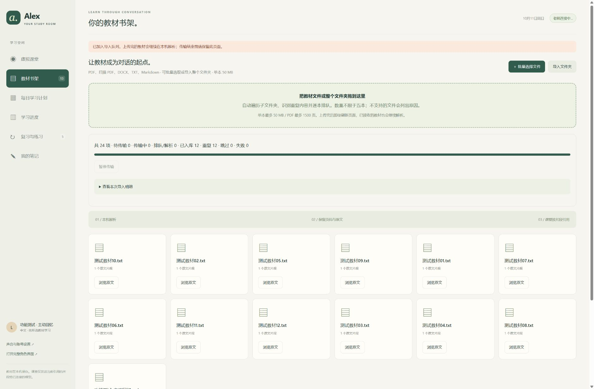
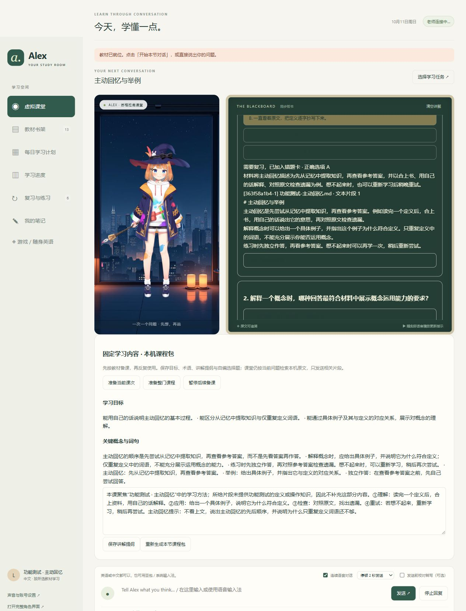
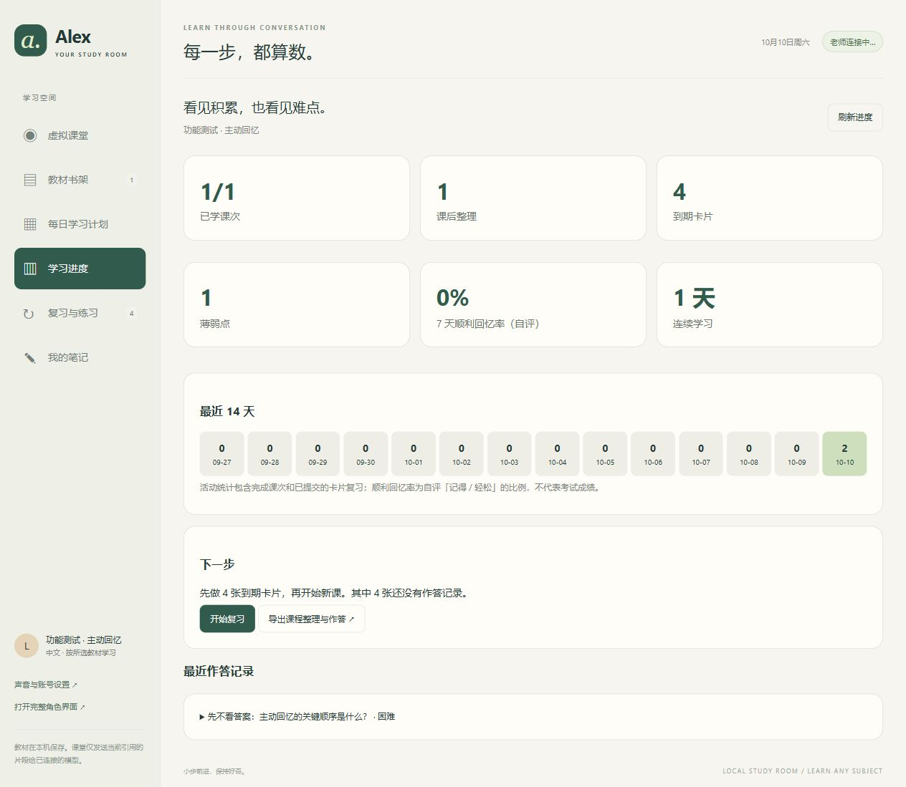

# Alex Learning · 虚拟学习课堂

用自己的教材，与虚拟老师一问一答地学习。Windows 本地运行，支持原版 PDF 伴读、连续语音、同步小黑板、课程计划、课后整理和间隔复习。

**v0.7.0 扫描页与看图伴读**：为扫描PDF建立本机取词文字层；主动发送当前页给支持图片的模型，解释图表并继续语音讨论；从外部阅读器导回同版PDF批注，重复跳过、冲突保留。继续支持中英语义知识库、每日60分钟调整、连续语音、Obsidian和私人备份。[新版说明与验证](docs/RELEASE-0.7.0.md) · [操作说明](App/deployment/WORKSPACE-GUIDE.md)。

[新版功能说明](App/deployment/COMPANION-GUIDE.md) · **[下载 Windows 便携版](https://github.com/dreamlee666/alex-learning/releases/latest)** · [批量导入说明](App/deployment/IMPORT-GUIDE.md) · [开发说明](docs/DEVELOPMENT.md) · [隐私与数据](PRIVACY.md)

软件免费下载。每位使用者配置自己的模型账号、API 或本机 Ollama；云端服务可能收费，不提供共享账号或免费 API 额度。仓库用于发布源码与下载包，课堂运行在你的电脑上。

## 三步开始

1. 在 Releases 下载 `Alex-Learning-Windows-0.7.0.zip`，**完整解压**，双击 `Alex-Learning.exe`。无需另装 Python；首次启动会联网下载并校验少量运行组件。
2. 在「声音与账号设置」选择 AI 来源，填写模型配置并测试回答。支持 ChatGPT 授权、DeepSeek、通义千问/百炼、豆包/火山方舟、Ollama 和其他兼容接口。授权与可用额度以各服务返回结果为准。
3. 打开「教材书架」导入教材 → 「每日学习计划」创建课程 → 选择课次开始对话。允许麦克风后，点一次录音即可连续交流；也可以直接打字。

适用 Windows 10/11 x64；建议至少 8 GB 内存，语音默认在 CPU 上运行。解压后的运行环境约 2 GB，首次下载、教材与 OCR 还需要额外磁盘空间。

## 群星英语伴读（v0.4.1）

打开「游戏 / 随身英语」→ 从自己的群星安装导入词库 → 打开取词助手。**Ctrl + Alt + Q** 框选本机 OCR；**Ctrl + Alt + E** 把 TTime 或其他工具的剪贴板文字送到课堂。文字自动载入副屏，点击单词问老师；当前对话结束后再载入下一段。也可双击包内「启动群星英语伴读.cmd」。

[群星伴读与 TTime 设置说明](App/deployment/STELLARIS-GUIDE.md)。不需要额外显卡驱动，截图在本机识别。游戏语料由每位使用者从自己的安装建立，不随软件发布。OCR 可能识别错字，请结合原文候选核对。

还提供一个独立的[群星游戏内双语 MOD 生成器（试用版）](docs/STELLARIS-BILINGUAL.md)：从自己的本体和启用 MOD 文本生成英文／中文同屏显示，无需 OCR 或 AI。需在群星启动器启用；游戏内排版尚未实测。生成的游戏文本不公开分发。

## 可以怎样学

| 环节 | 功能 |
| --- | --- |
| 教材 | PDF（含扫描 OCR）、DOCX、TXT、Markdown；整文件夹及子文件夹、拖拽、批量排队、重复识别与失败重试 |
| 计划 | 自定义学科、教学语言、基础和每日时长；分课程保存，SQE 与英语是可选模式 |
| 上课 | 苏格拉底式逐步追问；连续语音自动发送；可选转写校对；原文、页码与讲解同步显示 |
| 发言 | 实时显示完成转写的句子，保存修正、英语表达分析与导出，无需确认后发送 |
| 备课与板书 | 按课次缓存目标、术语、提纲和选择题；提交后显示解释与原文，答错加入 FSRS |
| 游戏 | 群星本机英汉词库、Steam 自动发现、按需框选 OCR、TTime 剪贴板接入、游戏原文核对、词句复习 |
| 课后 | 根据教材和本课对话生成总结、回忆卡和应用练习，先作答再看答案 |
| 复习 | FSRS 卡片排期、薄弱点、作答记录、活动与进度统计、Markdown 导出 |
| 知识库 | 本机中英语义与关键词混合检索、原文位置、增量索引；首次启用下载约135MB公开模型 |
| 每日调整 | 依据近期独立作答与可选英语诊断分配60分钟；显示原因与样本量，证据不足保留基础路线 |
| 文档增强 | 扫描页本机OCR文字层、当前页图像提问、外部同版PDF批注导回合并 |

导入不再限制每次五本；单本最多 50 MB，PDF 最多 1500 页。大批扫描书需要等待本机 OCR。导入是建立可检索的教材库，不会重新训练底层模型；往书架添加教材后，需要在新课程计划中选择它们。

以上截图使用独立功能测试数据。

## 模型和网络

- 兼容接口使用 OpenAI Chat Completions 协议；模型 ID 或火山方舟接入点 ID 请按服务商控制台填写。第三方预设未逐一使用付费账号实测。
- Ollama 需要自行安装、下载并启动模型，配置本机地址和模型名称；此包不包含本地对话大模型。
- 英语语音合成和 Whisper 语音识别在本机执行；中文语音使用联网 Edge TTS。选用云端模型时，课堂问题、相关教材片段和对话会发送给选定服务。
- ChatGPT 授权是否可用取决于账户及官方授权流程；不保证所有订阅都能使用。

## 版本与排错

当前版本 **0.7.0**：阅读位置、高亮、问题、课程和复习记录保留。语义检索仍可能遗漏，OCR和图像解释可能出错，学习诊断为AI建议。外部PDF批注需主动导回合并，不自动同步删除或镜像文件。音素级发音评分尚未实现。第三方付费API与视觉模型未逐一使用真实密钥验证，图像功能需所选模型支持。

端口为 `32193 / 32194 / 32195`。启动后学习空间是 `http://127.0.0.1:32194/study`。已有同一软件运行时会复用；其他软件占用端口时需要自行调整或关闭对应软件。

分享时请转发 **Releases 原始 ZIP**，不要压缩用过的软件目录。账号、教材、进度和会话的存放位置见 [PRIVACY.md](PRIVACY.md)。程序未做代码签名；校验值见 `SHA256SUMS.txt`，请核对下载来源。

## 许可与致谢

基于 [Open-LLM-VTuber](https://github.com/Open-LLM-VTuber/Open-LLM-VTuber) 及其 [Web 前端](https://github.com/Open-LLM-VTuber/Open-LLM-VTuber-Web)。课堂与启动器代码采用 MIT，保留原作者声明。角色、SDK、模型和依赖分别适用各自许可，**并非全部 MIT**；详见 [THIRD_PARTY.md](THIRD_PARTY.md) 和 `licenses/`。

使用固定的 Live2D 原创示例 Mao，不提供人物扩展接口。英语声线使用 Kokoro 混音与音色调整，与 Neuro-sama 无关联。没有附带商业 SQE 教材、个人教材或真实用户学习记录。

This content uses sample data owned and copyrighted by Live2D Inc. The sample data are utilized in accordance with terms and conditions set by Live2D Inc. This content itself is created at the author's sole discretion.

复习调度直接使用 [Py-FSRS](https://github.com/open-spaced-repetition/py-fsrs)；教学交互参考项目和区别见 [学习功能与参考](App/deployment/LEARNING-REFERENCES.md)。AI 生成内容、练习和学习统计不构成官方考试评分或成绩保证。
